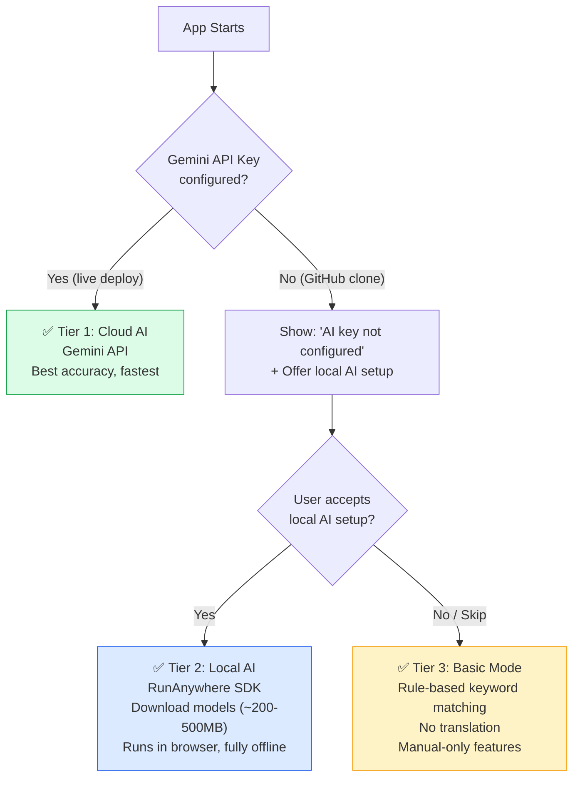
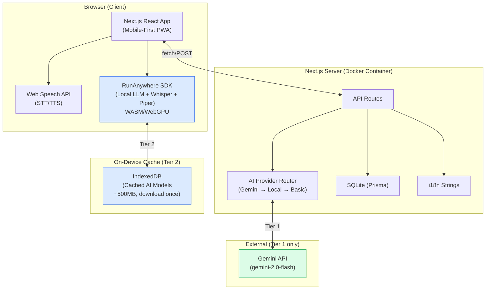
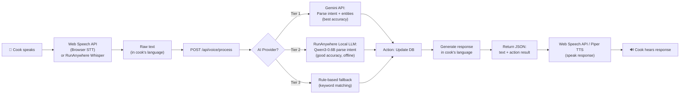
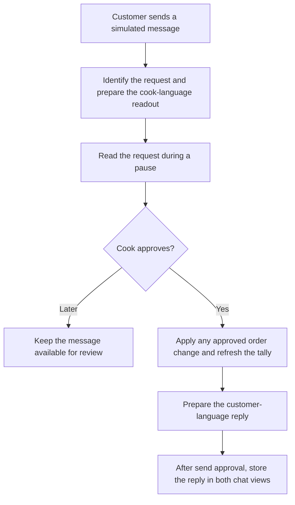

# RasoiSaathi — Build Plan (Round 2)

> **Foreground Kitchen Mode update (28 Nov 2026).** The wake word is **Saathi**. When microphone permission is granted, Kitchen Mode starts as soon as the foreground app opens. The cook can say the wake word and command together. Routine requests use local parsing for a quicker response. Review and approval come before a simulated order change, reply, reminder, or menu send. See the [kitchen roadmap](KITCHEN-ROADMAP.md) for the phases and phone sign-off.

> **Accepted update (27 Nov 2026):** Gemini keys are configured only in the server environment. No app key-entry forms, browser key storage, or client-key headers. Configured Gemini is the automatic default, regardless of remembered fallback preferences, with no missing-key message. Without a key, display the unavailable status and retain Basic Mode plus optional Local AI. This decision supersedes the older setup wireframes and code sketches below.
>
> **Voice completion scope:** M opens and activates the voice console; M toggles listening there; Escape stops recognition/TTS. Ignore shortcuts while typing or using dialogs. Require final transcripts, reject low-confidence speech, guard overlapping submissions and stale callbacks, update SQLite and refresh affected data, and speak the result. Persist dictated menus and explicitly confirmed full monthly payment receipts. Always-on wake words, Whisper/Piper, production WhatsApp sending, and full offline database access remain future work.
>
> **Verification:** build, typecheck, lint, unit tests, browser speech-event regressions with an isolated database, and an isolated keyless Docker cold-start. Real microphone/noisy-kitchen testing is separate. Video, pitch deck, and deployment remain deferred.
>
> **Verified on 27 Nov 2026:** 32 unit tests, 6 mobile browser tests against the production Docker app, typecheck/lint, Node 22 production builds, isolated no-key API workflows, one approved live Gemini tally request using seeded demo data, and keyless Compose startup/restart persistence all passed. Existing Next.js 14 dependency audit findings still need review before public deployment; no framework migration was included in this work.

> [!IMPORTANT]
> **Deadline**: November 30, 11:59 PM IST
> **Time available**: ~4 days (Nov 27-30)
> **Deliverables**: GitHub repo + Docker + YouTube demo (3 min) + Pitch deck (PDF) + Live link (optional)

---

## 1. What We Are Building

A **voice-first web application** (PWA) that acts as a business manager for women running home-based tiffin services in India. The cook talks to it in her mother tongue while cooking. It handles order tallying, customer management, payment tracking, multilingual translation, menu broadcasting, and WhatsApp message processing, all through voice.

**The prototype must demonstrate the core voice-first workflow end to end**, not every feature at production scale.

### Reference UI Inspiration

The reference image shows a clean mobile-first design with:
- Warm personal greeting at top
- Card-based content blocks with rounded corners
- Chat/conversation interface with voice waveform visualization
- Quick-action chips for fast replies
- Bottom navigation bar
- Soft purple/violet accent color palette
- Progress/stats cards with colorful icons


We will adapt this aesthetic for RasoiSaathi's kitchen/tiffin context: warm orange-saffron accents, large touch targets, icon-heavy navigation, and a prominent always-visible mic button.

---

## 2. Tech Stack

| Layer | Technology | Why |
|-------|-----------|-----|
| **Framework** | Next.js 14 (App Router) | Full-stack React, API routes, SSR, easy Docker deployment |
| **Styling** | Tailwind CSS + shadcn/ui | Rapid, consistent UI with accessible components |
| **Database** | SQLite via Prisma ORM | Zero-config, single file, no extra Docker container needed |
| **Voice Input (STT)** | Web Speech API (browser) + RunAnywhere Whisper (local fallback) | Free browser-native STT; RunAnywhere provides offline Whisper STT when browser API unavailable |
| **Voice Output (TTS)** | Web Speech API + RunAnywhere Piper/Kokoro (local fallback) | Browser-native TTS with offline local TTS fallback via RunAnywhere |
| **AI / NLP (Cloud)** | Gemini API (gemini-2.0-flash) | Intent parsing, translation, conversational responses. Used on live deployed version |
| **AI / NLP (Local)** | RunAnywhere SDK (`@runanywhere/web`) | On-device LLM (Qwen3-0.6B / SmolLM2-360M) for intent parsing + translation when no API key. Runs entirely in browser via WASM/WebGPU |
| **WhatsApp Sim** | Simulated inbox in the app | Real WhatsApp Business API needs keys; we simulate the message feed |
| **Containerization** | Docker + docker-compose.yml | Single `docker-compose up` to start |
| **Language** | TypeScript throughout | Type safety, better DX |
| **State Management** | React Context + SWR for data fetching | Lightweight, sufficient for prototype |
| **Icons** | Lucide React | Clean, consistent icon set |
| **Deployment (optional)** | Vercel or Railway | Free tier, easy deploy for live link |
| **Mobile Target** | Responsive PWA (mobile-first) | 99% users will be on mobile browsers. PWA installable on Android/iOS homescreen |

### Key Design Decisions

> [!NOTE]
> **Why Next.js over Flutter/React Native?**
> The hackathon requires Docker + `docker-compose up` to start the app. A web app (responsive/PWA) is the simplest path. Flutter web adds complexity; native mobile can't be Docker-started. Next.js gives us a full-stack app in one container that works on any device browser. And since 99% of our target users (home cooks) will access this on their phone, we design mobile-first and use PWA for homescreen install.

> [!NOTE]
> **Why SQLite over PostgreSQL?**
> SQLite runs inside the same container, no extra service. For a prototype with one cook's data, it's perfect. Prisma ORM means we can swap to Postgres later with zero code changes.

> [!NOTE]
> **Why RunAnywhere SDK for local AI?**
> RunAnywhere is an open-source SDK that runs AI models (LLM, STT, TTS) entirely on-device in the browser via WASM/WebGPU. It supports Whisper (speech-to-text), Piper/Kokoro (text-to-speech), and small LLMs like Qwen3-0.6B (intent parsing + translation). This means anyone who clones the GitHub repo can run the full AI experience without any API key at all. Models are downloaded once and cached in the browser using IndexedDB. Works offline after first load. Supports Android Chrome, iOS Safari (17+), and desktop browsers.

> [!NOTE]
> **Why Web Speech API + Gemini as the primary path?**
> On the live deployed version, we use Gemini API (our key, pre-configured) for maximum accuracy in intent parsing, translation, and multilingual responses. Web Speech API provides free, instant browser-native STT/TTS. This is the best experience. RunAnywhere is the fallback for self-hosted/cloned setups.

---

## 2.1 AI Provider Strategy (Three-Tier Fallback)

This is the core design decision for how the app handles AI features across different deployment scenarios.

### The Three Scenarios



### Tier 1: Cloud AI (Gemini API) — Live Deployed Version

This is what runs on our live deployed link. We configure the Gemini API key in our environment.

| Feature | How It Works |
|---------|-------------|
| Intent parsing | Gemini 2.0 Flash processes voice text, returns structured JSON with intent + entities |
| Translation | Gemini translates between Hindi, English, Kannada, Tamil, Telugu, Marathi |
| Voice responses | Gemini generates natural conversational responses in cook's language |
| WhatsApp processing | Gemini detects intent from customer messages, generates auto-replies |
| Menu broadcast | Gemini translates menu to all customer languages |

**Accuracy**: Highest. Gemini handles code-switching (Hinglish), regional food terms, and nuanced intent.
**Speed**: Fast (API call ~200-500ms).
**Cost**: Free tier (15 RPM, sufficient for prototype demo).

### Tier 2: Local AI (RunAnywhere SDK) — GitHub Clone Without API Key

When someone clones the repo and starts the app without configuring a Gemini API key, the app shows a friendly screen:

```
┌──────────────────────────────────────┐
│                                      │
│  ⚠️ AI Key Not Configured            │
│                                      │
│  RasoiSaathi works best with a       │
│  Gemini API key for smart features   │
│  like translation and voice          │
│  commands.                           │
│                                      │
│  But you can also run AI locally     │
│  on your device — no key needed,     │
│  no data leaves your phone!          │
│                                      │
│  ┌────────────────────────────────┐  │
│  │ 🧠 Set Up Local AI (~500 MB)   │  │
│  │    Download once, works offline │  │
│  └────────────────────────────────┘  │
│                                      │
│  ┌────────────────────────────────┐  │
│  │ 🔑 Enter Gemini API Key        │  │
│  │    Get free key from Google AI  │  │
│  └────────────────────────────────┘  │
│                                      │
│  ┌────────────────────────────────┐  │
│  │ ⏭️ Skip — Use Basic Mode       │  │
│  │    Limited features, no AI      │  │
│  └────────────────────────────────┘  │
│                                      │
└──────────────────────────────────────┘
```

**If user chooses "Set Up Local AI":**

1. App initializes RunAnywhere SDK in the browser
2. Downloads models (one-time, cached in IndexedDB):
   - **LLM**: Qwen3-0.6B or SmolLM2-360M (~200-400MB) for intent parsing + translation
   - **STT**: Whisper Tiny/Base (~75-150MB) for local speech-to-text (supplements Web Speech API)
   - **TTS**: Piper (~30MB) for local text-to-speech
3. Shows progress bar during download: "Downloading AI model... 65%"
4. Once downloaded, models are cached. Next time app opens, they load from local cache (5-10 seconds)
5. All AI processing happens in-browser. Zero data leaves the device.

```typescript
// lib/runanywhere.ts — Local AI setup

import { RunAnywhere, SDKEnvironment } from '@runanywhere/web';
import { LlamaCPP } from '@runanywhere/web-llamacpp';
import { ONNX } from '@runanywhere/web-onnx';

export async function initLocalAI(onProgress: (pct: number, msg: string) => void) {
  // Register inference backends
  await LlamaCPP.autoRegister();
  await ONNX.autoRegister();
  
  // Initialize SDK
  await RunAnywhere.initialize({
    environment: SDKEnvironment.SDK_ENVIRONMENT_PRODUCTION,
  });
  
  onProgress(10, 'AI engine ready. Downloading language model...');
  
  // The SDK handles model download + caching automatically
  // First run: downloads from CDN → caches in IndexedDB
  // Subsequent runs: loads from local cache
  
  return true;
}

export async function localIntentParse(text: string, cookLang: string, context: object) {
  const systemPrompt = `You are RasoiSaathi, a tiffin business assistant.
Parse this voice command and return JSON:
{"intent": "tally|skip|cancel|pause|add_customer|payment_check|menu_broadcast|unknown",
 "entities": {"customer_name": "...", "date": "...", "dietary_pref": "..."},
 "response_text": "Natural response in ${cookLang}"}
Context: ${JSON.stringify(context)}`;

  const response = await RunAnywhere.llm.generate({
    prompt: `${systemPrompt}\n\nUser said: "${text}"`,
    options: {
      model: 'qwen3-0.6b',
      maxOutputTokens: 200,
      temperature: 0.3,  // Low temp for structured output
    }
  });
  
  return JSON.parse(response.text);
}

export async function localTranslate(text: string, fromLang: string, toLang: string) {
  const response = await RunAnywhere.llm.generate({
    prompt: `Translate this from ${fromLang} to ${toLang}. Return ONLY the translation, nothing else.\n\n"${text}"`,
    options: { model: 'qwen3-0.6b', maxOutputTokens: 200, temperature: 0.1 }
  });
  
  return response.text.trim();
}

export async function localSTT(audioBlob: Blob): Promise<string> {
  // RunAnywhere Whisper for local speech-to-text
  const session = await RunAnywhere.voice.createSession({
    stt: { id: 'whisper-base' },
  });
  const result = await session.transcribe(audioBlob);
  return result.text;
}
```

**RunAnywhere local AI performance on mobile:**

| Device | Model | Speed | Notes |
|--------|-------|-------|-------|
| Modern Android (2022+) with WebGPU | Qwen3-0.6B | ~15-30 tokens/sec | Good experience |
| Mid-range Android (WASM fallback) | SmolLM2-360M | ~5-10 tokens/sec | Acceptable for short responses |
| iPhone 13+ (Safari WebGPU) | Qwen3-0.6B | ~20-40 tokens/sec | Apple silicon is fast |
| Older phones | SmolLM2-135M | ~3-8 tokens/sec | Minimal viable experience |

### Tier 3: Basic Mode (No AI at all) — Skip

If the user skips both API key and local AI, the app still works with limited features:

| Feature | Behavior in Basic Mode |
|---------|----------------------|
| Dashboard | Fully functional — tally, customers, payments from local DB |
| Customer CRUD | Fully functional — add, edit, delete customers manually |
| Payment tracking | Fully functional — mark paid/pending manually |
| Voice commands | Web Speech API captures text, but intent parsing uses simple keyword matching (less accurate) |
| Translation | Disabled — shows original text only. Banner: "Set up AI for translation" |
| WhatsApp processing | Basic keyword detection ("cancel", "skip", "extra") works. No translation. |
| Menu broadcast | Saves in cook's language only. No auto-translation. |

### How the AI Provider is Selected (Runtime Logic)

```typescript
// lib/ai-provider.ts

export type AIProvider = 'gemini' | 'local' | 'basic';

export function getAIProvider(): AIProvider {
  // Check for Gemini API key (from env or user-entered in settings)
  if (process.env.GEMINI_API_KEY) {
    return 'gemini';
  }
  
  // Check if RunAnywhere local models are initialized
  if (isLocalAIReady()) {
    return 'local';
  }
  
  // Fallback to basic keyword matching
  return 'basic';
}

// Unified interface — all three tiers implement the same functions
export async function processVoiceCommand(text: string, cookLang: string, ctx: object) {
  const provider = getAIProvider();
  
  switch (provider) {
    case 'gemini':
      return geminiIntentParse(text, cookLang, ctx);    // Best accuracy
    case 'local':
      return localIntentParse(text, cookLang, ctx);     // Good accuracy, offline
    case 'basic':
      return fallbackKeywordParse(text);                // Basic keyword matching
  }
}

export async function translateText(text: string, from: string, to: string) {
  const provider = getAIProvider();
  
  switch (provider) {
    case 'gemini':
      return geminiTranslate(text, from, to);
    case 'local':
      return localTranslate(text, from, to);
    case 'basic':
      return { translated: text, error: 'AI not configured — showing original text' };
  }
}
```

### Next.js Config for RunAnywhere (Cross-Origin Isolation)

RunAnywhere's WASM backend requires `SharedArrayBuffer`, which needs cross-origin isolation headers:

```javascript
// next.config.js
const nextConfig = {
  output: 'standalone',  // For Docker
  async headers() {
    return [
      {
        source: '/:path*',
        headers: [
          { key: 'Cross-Origin-Opener-Policy', value: 'same-origin' },
          { key: 'Cross-Origin-Embedder-Policy', value: 'credentialless' },
          // 'credentialless' instead of 'require-corp' so external
          // assets (CDN fonts, images) still load without CORP headers
        ],
      },
    ];
  },
};
```

---

## 3. Features

### 3.1 Core Features (Must Build for Prototype)

These are the features we will demo in the 3-minute video.

#### F1: Voice-First Dashboard
- Prominent mic button (always visible, floating)
- Tap-to-talk or M-key activation (always-on wake word deferred)
- Voice command: "Aaj kitne tiffin?" gets spoken answer with today's tally
- Dashboard cards: total tiffins today, cancellations, pending payments, dietary breakdown
- Language selector (Hindi, English, Kannada, Tamil, Telugu, Marathi)

#### F2: Customer Management
- Add customer via voice: "Naya customer jodo, naam Vikram, Jain khana, monthly 3000"
- List all customers with status (active, paused, cancelled)
- Edit subscription details (price, dietary preference, delivery address)
- Quick actions: pause, resume, cancel subscription
- Customer cards with color-coded status

#### F3: Daily Order Tally (The Morning Brief)
- Auto-calculated from active subscriptions minus today's cancellations/skips
- Dietary breakdown: Regular, Jain, Less-oil, No-onion-garlic, etc.
- Special requests highlighted (extra roti, different menu, etc.)
- Voice readout of full tally on command
- Real-time updates as WhatsApp messages are processed

#### F4: Payment Tracker
- Monthly payment status per customer (Paid / Pending / Partial)
- Total pending amount calculation
- Voice command: "Kisne payment nahi kiya?" gets spoken list
- One-tap or voice-trigger to send payment reminders
- Payment history log per customer
- UPI payment link generation (simulated)

#### F5: Simulated WhatsApp Message Processing
- Inbox showing incoming customer messages (pre-seeded + user can add)
- AI processes each message to detect intent (cancel, skip, pause, change preference, etc.)
- Auto-updates tally and customer status
- Shows auto-reply preview in customer's language
- Demonstrates the multilingual bridge in action

#### F6: Multilingual Voice Interface
- Cook selects her preferred language during onboarding
- All UI text, voice responses, and announcements in her language
- When a "customer message" arrives in a different language, it gets:
  1. Translated to cook's language for the voice announcement
  2. Original + translated text shown on screen
  3. Auto-reply generated in customer's language
- Supported languages for prototype: Hindi, English, Kannada (extendable)

#### F7: Menu Broadcast
- Cook dictates tomorrow's menu via voice
- Preview shows the menu translated into each customer's language
- "Send" broadcasts to all active subscribers (simulated WhatsApp send)
- Dietary-specific notes auto-appended (e.g., "Jain version: without onion-garlic")

### 3.2 Extension Features (Nice-to-Have, If Time Permits)

| Feature | Description | Priority |
|---------|------------|----------|
| Voice onboarding wizard | Step-by-step voice-guided setup for first-time cook | Medium |
| Analytics dashboard | Weekly/monthly stats: revenue, waste, customer trends | Low |
| Customer-facing order page | Shareable link where customers can skip/pause/pay | Low |
| Delivery scheduling | Route-based delivery order with time estimates | Low |
| Ingredient estimator | "2 kilo dahi, 5 kilo aata" based on tally + menu | Medium |
| PWA install prompt | Add-to-homescreen for mobile users | Medium |
| Dark mode / high contrast | Accessibility for different lighting conditions | Low |

---

## 4. UI/UX Design

### 4.1 Design Principles

1. **Voice-first, touch-second**: The mic button is the most prominent UI element. Every action can be done by voice. Touch is a fallback, not the primary mode.
2. **Large, forgiving touch targets**: Minimum 48px tap targets. No tiny buttons. Cook's hands may be slightly wet/oily.
3. **Icon-heavy, text-light**: Icons communicate faster than text, especially across languages. Labels are short.
4. **Multilingual from the ground up**: All UI strings are i18n-ready. Language picker is accessible from every screen.
5. **High contrast, warm palette**: Kitchen environments have variable lighting. Use strong contrast. Warm saffron/orange tones feel approachable, not "corporate tech."
6. **Card-based layout**: Scannable at a glance. Each card is one piece of information.
7. **Status colors are universal**: Green = paid/active, Red = pending/urgent, Yellow = paused, Blue = info.

### 4.2 Color Palette

```
Primary (Saffron):    #F97316 (orange-500)
Primary Dark:         #EA580C (orange-600)
Accent (Warm Purple): #7C3AED (violet-600) — for active/interactive elements
Background:           #FFF7ED (orange-50) — warm off-white
Surface (Cards):      #FFFFFF
Text Primary:         #1C1917 (stone-900)
Text Secondary:       #78716C (stone-500)
Success (Paid):       #16A34A (green-600)
Warning (Paused):     #EAB308 (yellow-500)
Danger (Pending):     #DC2626 (red-600)
Info:                 #2563EB (blue-600)
```

### 4.3 Screen-by-Screen Layout

#### Screen 1: Onboarding (First-Time Only)
```
┌─────────────────────────────┐
│                             │
│      🍳 RasoiSaathi         │
│    "रसोई साथी"              │
│                             │
│   [Language Selector Grid]  │
│   Hindi | English | ಕನ್ನಡ    │
│   தமிழ் | తెలుగు | मराठी    │
│                             │
│   "Apni bhasha chunein"     │
│                             │
│   ┌─────────────────────┐   │
│   │  🎤 Bolkar batayein  │   │
│   └─────────────────────┘   │
│                             │
│   After language:           │
│   "Apna naam bolein"        │
│   "Kitne customers hain?"   │
│   "Monthly charge kitna?"   │
│                             │
└─────────────────────────────┘
```

#### Screen 2: Dashboard (Home — Main Screen)
```
┌─────────────────────────────┐
│ 🍳 Namaste, Sunita didi!    │
│ Aaj Thursday, 28 Nov        │
│                             │
│ ┌─────────────────────────┐ │
│ │ 🍱 Aaj Ka Tiffin         │ │
│ │                           │ │
│ │  26 Total                 │ │
│ │  18 Regular  5 Jain      │ │
│ │  3 Less-oil              │ │
│ │  🔴 2 Cancel  🟢 1 Extra │ │
│ └─────────────────────────┘ │
│                             │
│ ┌──────────┐ ┌────────────┐ │
│ │ 💰 ₹14,200│ │ 📱 5 New   │ │
│ │  Pending  │ │  Messages  │ │
│ └──────────┘ └────────────┘ │
│                             │
│ ┌─────────────────────────┐ │
│ │ 📢 Recent Updates        │ │
│ │ • Rajesh ne cancel kiya  │ │
│ │ • Pooja: 2 extra roti    │ │
│ │ • Meena: 3 din pause     │ │
│ └─────────────────────────┘ │
│                             │
│         🎤 (BIG MIC)        │
│    "RasoiSaathi se baat     │
│         karein"             │
│                             │
│ ─── ─── ─── ─── ─── ───    │
│ 🏠   👥   💰   📋   ⚙️     │
│ Home Cust Pay  Menu  Set    │
└─────────────────────────────┘
```

#### Screen 3: Voice Conversation Interface
When the mic button is tapped or wake word detected:
```
┌─────────────────────────────┐
│          ← Back             │
│                             │
│ 🤖 "Namaste didi! Kya      │
│    madad chahiye?"          │
│                   10:58 AM  │
│                             │
│         👩‍🍳 "Aaj kitne     │
│         tiffin banane       │
│         hain?"              │
│                   10:58 AM  │
│                             │
│ 🤖 "Aaj total 26 tiffin    │
│    hain. 18 regular, 5      │
│    Jain, 3 less-oil.        │
│    Rajesh ne raat ko cancel │
│    kiya, Pooja ne 2 extra   │
│    roti maangi."            │
│                   10:59 AM  │
│                             │
│   ┌─────────────────────┐   │
│   │  ~~~~ waveform ~~~~ │   │
│   │       🎤  01:24     │   │
│   │  "Bolein..."        │   │
│   └─────────────────────┘   │
│                             │
└─────────────────────────────┘
```

#### Screen 4: Customer List
```
┌─────────────────────────────┐
│ 👥 Customers          + Add │
│ ┌─────────────────────────┐ │
│ │ 🔍 Search / 🎤 Voice    │ │
│ └─────────────────────────┘ │
│                             │
│ Active (24)  Paused (2)     │
│                             │
│ ┌─────────────────────────┐ │
│ │ 🟢 Rajesh Kumar          │ │
│ │ Regular • ₹3,000/mo      │ │
│ │ 💰 Paid ✅               │ │
│ └─────────────────────────┘ │
│ ┌─────────────────────────┐ │
│ │ 🟢 Priya Sharma          │ │
│ │ Jain • ₹3,500/mo         │ │
│ │ 💰 Pending ₹3,500 🔴    │ │
│ └─────────────────────────┘ │
│ ┌─────────────────────────┐ │
│ │ 🟡 Meena Ji              │ │
│ │ Less-oil • ₹2,800/mo     │ │
│ │ ⏸️ Paused (3 days)       │ │
│ └─────────────────────────┘ │
│                             │
│         🎤 (MIC)            │
│ ─── ─── ─── ─── ─── ───    │
│ 🏠   👥   💰   📋   ⚙️     │
└─────────────────────────────┘
```

#### Screen 5: Payment Tracker
```
┌─────────────────────────────┐
│ 💰 Payments — November      │
│                             │
│ ┌──────────┐ ┌────────────┐ │
│ │ ₹66,000  │ │ ₹14,200    │ │
│ │ Collected│ │ Pending    │ │
│ │ 🟢       │ │ 🔴         │ │
│ └──────────┘ └────────────┘ │
│                             │
│ Pending (6)                 │
│ ┌─────────────────────────┐ │
│ │ Priya     ₹3,500        │ │
│ │ Amit      ₹2,500        │ │
│ │ Sanjay    ₹3,500        │ │
│ │ Deepa     ₹2,000        │ │
│ │ ...                      │ │
│ └─────────────────────────┘ │
│                             │
│ ┌─────────────────────────┐ │
│ │ 📤 Sabko Reminder Bhejo  │ │
│ └─────────────────────────┘ │
│                             │
│         🎤 (MIC)            │
│ ─── ─── ─── ─── ─── ───    │
│ 🏠   👥   💰   📋   ⚙️     │
└─────────────────────────────┘
```

#### Screen 6: WhatsApp Inbox (Simulated)
```
┌─────────────────────────────┐
│ 📱 Customer Messages        │
│                             │
│ ┌─────────────────────────┐ │
│ │ 🟢 Processed             │ │
│ │ Rajesh (Hindi):           │ │
│ │ "Aaj skip kardo"          │ │
│ │ → Intent: Skip today      │ │
│ │ → Tally updated: 26→25   │ │
│ │ → Auto-reply: "✅ Aaj ka │ │
│ │   tiffin skip ho gaya"   │ │
│ └─────────────────────────┘ │
│ ┌─────────────────────────┐ │
│ │ 🔵 New (English → Kannada)│ │
│ │ Sarah (English):          │ │
│ │ "Skip tomorrow, office    │ │
│ │  party"                   │ │
│ │ → ಕನ್ನಡ: "ನಾಳೆ ಟಿಫಿನ್    │ │
│ │   ಬೇಡ, ಆಫೀಸ್ ಪಾರ್ಟಿ ಇದೆ"  │ │
│ │ [Process ✓] [Ignore ✗]   │ │
│ └─────────────────────────┘ │
│                             │
│ ┌─────────────────────────┐ │
│ │ ➕ Simulate New Message   │ │
│ └─────────────────────────┘ │
│                             │
│         🎤 (MIC)            │
│ ─── ─── ─── ─── ─── ───    │
│ 🏠   👥   💰   📋   ⚙️     │
└─────────────────────────────┘
```

#### Screen 7: Settings
```
┌─────────────────────────────┐
│ ⚙️ Settings                 │
│                             │
│ 🌐 Language                 │
│ [Hindi ▾]                   │
│                             │
│ 🔑 Gemini API Key           │
│ [Enter key...        ] [✓] │
│ Status: ✅ Connected        │
│ (or ⚠️ Not configured —    │
│  AI features disabled)      │
│                             │
│ 👩‍🍳 Cook Profile             │
│ Name: Sunita                │
│ Phone: +91 98xxx            │
│                             │
│ 🍱 Business Settings        │
│ Default price: ₹3,000/mo   │
│ Dietary options: Regular,   │
│ Jain, Less-oil, No-onion   │
│                             │
│ 📊 Data                     │
│ [Export Data] [Reset Demo]  │
│                             │
│ ─── ─── ─── ─── ─── ───    │
│ 🏠   👥   💰   📋   ⚙️     │
└─────────────────────────────┘
```

### 4.4 Responsive Design Strategy — Mobile-First

Since 99% of our users (home cooks) will access RasoiSaathi on their mobile phones, **mobile is the primary design target, not an afterthought.**

#### Mobile-First Principles

1. **Design for 360px width first**, then scale up. Never the other way around.
2. **Touch targets minimum 48x48px** — cook's hands may be slightly damp or oily.
3. **Bottom navigation** — thumb-reachable on one hand. No hamburger menus.
4. **Floating mic button** — always visible, always reachable at bottom-center. 64x64px minimum.
5. **No horizontal scrolling** — ever. All content stacks vertically.
6. **Large readable text** — minimum 16px body, 20px+ for important numbers (tally count, payment amounts).
7. **Minimal typing** — everything achievable via voice or taps. The keyboard should rarely appear.
8. **PWA installable** — `manifest.json` with app name, icons, theme color. Users can "Add to Home Screen" and it feels like a native app with no browser chrome.

#### PWA Configuration

```json
// public/manifest.json
{
  "name": "RasoiSaathi - Kitchen Companion",
  "short_name": "RasoiSaathi",
  "description": "Voice-first AI business partner for tiffin services",
  "start_url": "/",
  "display": "standalone",
  "orientation": "portrait",
  "background_color": "#FFF7ED",
  "theme_color": "#F97316",
  "icons": [
    { "src": "/icons/icon-192.png", "sizes": "192x192", "type": "image/png" },
    { "src": "/icons/icon-512.png", "sizes": "512x512", "type": "image/png" }
  ]
}
```

#### Viewport Behavior

| Viewport | Layout | Notes |
|----------|--------|-------|
| **Mobile (< 640px)** | Full-width cards, bottom nav, floating mic, single column | **Primary target.** This is where 99% of users will be |
| **Tablet (640-1024px)** | 2-column grid for dashboard cards, same bottom nav | Secondary — testing/demo convenience |
| **Desktop (> 1024px)** | Centered max-width container (420px) with phone-frame look | For hackathon evaluators viewing on desktop. Shows a phone-like preview |

#### Mobile Browser Compatibility

| Browser | STT | TTS | RunAnywhere (Local AI) | PWA Install |
|---------|-----|-----|----------------------|-------------|
| **Chrome Android** | ✅ Full (`hi-IN`, `kn-IN`, `ta-IN`) | ✅ Full | ✅ WebGPU + WASM | ✅ Full |
| **Samsung Internet** | ✅ Full (Chromium-based) | ✅ Full | ✅ WASM, partial WebGPU | ✅ Full |
| **Safari iOS 17+** | ⚠️ Partial (English/Hindi best) | ✅ Full | ✅ WebGPU on A15+ chips | ✅ Full |
| **Edge Android** | ✅ Full (Chromium-based) | ✅ Full | ✅ WebGPU + WASM | ✅ Full |
| **Firefox Android** | ❌ No Web Speech API | ✅ Partial | ✅ WASM only | ⚠️ Limited |

> [!TIP]
> **Our primary mobile target is Chrome on Android**, which covers ~70%+ of Indian smartphone users. This gives us full Web Speech API support for all Indian languages, full RunAnywhere WebGPU acceleration, and full PWA install capability. Safari iOS works for iPhone users with some limitations on STT language support.

#### Desktop Evaluator View

When hackathon evaluators open the app on desktop, they see a centered phone-frame layout:

```
┌─────────────────────────────────────────────────────┐
│                                                     │
│           ┌─────────────────────┐                   │
│           │  ┌───────────────┐  │                   │
│           │  │  RasoiSaathi  │  │                   │
│           │  │  Dashboard    │  │                   │
│           │  │  ...          │  │                   │
│           │  │  🎤 Mic       │  │                   │
│           │  │  ─── Nav ───  │  │                   │
│           │  └───────────────┘  │                   │
│           │     (420px wide)    │                   │
│           └─────────────────────┘                   │
│                                                     │
└─────────────────────────────────────────────────────┘
```

This makes it immediately obvious this is a mobile-first product, even when evaluators test on laptop.

---

## 5. Architecture

### 5.1 System Architecture



### 5.2 Voice Processing Pipeline



### 5.3 WhatsApp Message Processing Flow



### 5.4 Database Schema

```prisma
// prisma/schema.prisma

generator client {
  provider = "prisma-client-js"
}

datasource db {
  provider = "sqlite"
  url      = "file:./rasoisaathi.db"
}

model Cook {
  id              String     @id @default(cuid())
  name            String
  phone           String     @unique
  language        String     @default("hi") // hi, en, kn, ta, te, mr
  defaultPrice    Int        @default(3000)
  createdAt       DateTime   @default(now())
  customers       Customer[]
}

model Customer {
  id              String     @id @default(cuid())
  cookId          String
  cook            Cook       @relation(fields: [cookId], references: [id])
  name            String
  phone           String?
  language        String     @default("hi")
  dietaryPref     String     @default("regular") // regular, jain, less-oil, no-onion-garlic
  monthlyPrice    Int
  status          String     @default("active") // active, paused, cancelled
  pauseUntil      DateTime?
  specialNotes    String?
  createdAt       DateTime   @default(now())
  payments        Payment[]
  dailyOrders     DailyOrder[]
  messages        Message[]
}

model DailyOrder {
  id              String     @id @default(cuid())
  customerId      String
  customer        Customer   @relation(fields: [customerId], references: [id])
  date            DateTime
  status          String     @default("active") // active, skipped, cancelled, extra
  extraItems      String?    // "2 extra roti"
  createdAt       DateTime   @default(now())

  @@unique([customerId, date])
}

model Payment {
  id              String     @id @default(cuid())
  customerId      String
  customer        Customer   @relation(fields: [customerId], references: [id])
  month           String     // "2026-11"
  amount          Int
  status          String     @default("pending") // pending, paid, partial
  paidAmount      Int        @default(0)
  paidAt          DateTime?
  reminderSent    Boolean    @default(false)
  createdAt       DateTime   @default(now())

  @@unique([customerId, month])
}

model Message {
  id              String     @id @default(cuid())
  customerId      String?
  customer        Customer?  @relation(fields: [customerId], references: [id])
  senderName      String
  originalText    String
  originalLang    String
  translatedText  String?
  translatedLang  String?
  intent          String?    // skip, cancel, pause, extra, diet-change, payment, unknown
  status          String     @default("new") // new, processed, ignored
  autoReply       String?
  createdAt       DateTime   @default(now())
}

model MenuBroadcast {
  id              String     @id @default(cuid())
  date            DateTime
  menuText        String     // original in cook's language
  translations    String     // JSON: {"hi": "...", "en": "...", "kn": "..."}
  jainNote        String?
  sentAt          DateTime?
  createdAt       DateTime   @default(now())
}
```

### 5.5 API Routes

| Method | Route | Purpose | Needs API Key? |
|--------|-------|---------|----------------|
| GET | `/api/cook` | Get cook profile | No |
| PUT | `/api/cook` | Update cook profile/language | No |
| GET | `/api/customers` | List all customers | No |
| POST | `/api/customers` | Add new customer | No |
| PUT | `/api/customers/[id]` | Update customer | No |
| DELETE | `/api/customers/[id]` | Remove customer | No |
| GET | `/api/tally` | Get today's tally with breakdown | No |
| POST | `/api/voice/process` | Process voice command (intent parse) | Yes (graceful fallback) |
| GET | `/api/payments` | Get payment summary | No |
| POST | `/api/payments/[id]/mark-paid` | Mark payment as paid | No |
| POST | `/api/payments/remind` | Send payment reminders (simulated) | Yes (for translation) |
| GET | `/api/messages` | Get WhatsApp message feed | No |
| POST | `/api/messages` | Add simulated message | No |
| POST | `/api/messages/[id]/process` | Process a message (parse intent) | Yes (graceful fallback) |
| POST | `/api/menu/broadcast` | Create and broadcast menu | Yes (for translation) |
| POST | `/api/translate` | Translate text between languages | Yes |
| GET | `/api/health` | Health check for Docker | No |

### 5.6 Gemini API Integration + Unified AI Provider

```typescript
// lib/ai-provider.ts — Unified AI router

export type AITier = 'gemini' | 'local' | 'basic';

export function getCurrentTier(): AITier {
  // Tier 1: Gemini API key available
  if (process.env.GEMINI_API_KEY || getStoredApiKey()) return 'gemini';
  // Tier 2: RunAnywhere local models initialized and cached
  if (isLocalAIReady()) return 'local';
  // Tier 3: No AI — basic keyword matching
  return 'basic';
}

// Same interface regardless of tier
export async function processCommand(text: string, lang: string, ctx: object) {
  switch (getCurrentTier()) {
    case 'gemini':  return geminiProcess(text, lang, ctx);
    case 'local':   return localProcess(text, lang, ctx);
    case 'basic':   return keywordProcess(text);
  }
}
```

```typescript
// lib/gemini.ts — Tier 1: Cloud AI (used on live deployed version)

const SYSTEM_PROMPT = `You are RasoiSaathi, a voice assistant for Indian home-cook 
tiffin businesses. You understand Hindi, English, Kannada, Tamil, Telugu, and Marathi.

When given a voice command or customer message, respond with JSON:
{
  "intent": "tally | add_customer | skip | cancel | pause | resume | 
             extra | diet_change | payment_check | payment_remind | 
             menu_broadcast | greeting | unknown",
  "entities": {
    "customer_name": "...",
    "date": "...",
    "dietary_pref": "...",
    "extra_items": "...",
    "price": ...
  },
  "response_text": "Natural response in {cook_language}",
  "confidence": 0.0-1.0
}

Context: Cook speaks {cook_language}. 
Active customers: {customer_list}
Today's date: {today}
Current tally: {tally}`;

export async function geminiProcess(text: string, cookLang: string, context: object) {
  // Call Gemini API with structured output
}

export async function geminiTranslate(text: string, fromLang: string, toLang: string) {
  // Call Gemini for translation
}
```

```typescript
// lib/runanywhere.ts — Tier 2: Local AI (for GitHub clones without API key)

import { RunAnywhere } from '@runanywhere/web';
import { LlamaCPP } from '@runanywhere/web-llamacpp';
import { ONNX } from '@runanywhere/web-onnx';

let isInitialized = false;

export async function initLocalAI(onProgress: (pct: number, msg: string) => void) {
  await LlamaCPP.autoRegister();
  await ONNX.autoRegister();
  await RunAnywhere.initialize({ /* config */ });
  isInitialized = true;
  onProgress(100, 'Local AI ready!');
}

export function isLocalAIReady() { return isInitialized; }

export async function localProcess(text: string, lang: string, ctx: object) {
  const response = await RunAnywhere.llm.generate({
    prompt: buildPrompt(text, lang, ctx),
    options: { model: 'qwen3-0.6b', maxOutputTokens: 200, temperature: 0.3 }
  });
  return JSON.parse(response.text);
}

export async function localTranslate(text: string, from: string, to: string) {
  const response = await RunAnywhere.llm.generate({
    prompt: `Translate from ${from} to ${to}. Return ONLY the translation:\n"${text}"`,
    options: { model: 'qwen3-0.6b', maxOutputTokens: 200, temperature: 0.1 }
  });
  return response.text.trim();
}
```

**Rule-based fallback** (Tier 3 — when no AI at all):
```typescript
// lib/voice-fallback.ts — Tier 3: keyword matching
function keywordProcess(text: string) {
  const lower = text.toLowerCase();
  if (lower.includes("kitne tiffin") || lower.includes("how many") || lower.includes("tally"))
    return { intent: "tally" };
  if (lower.includes("cancel") || lower.includes("band"))
    return { intent: "cancel" };
  if (lower.includes("skip") || lower.includes("aaj nahi"))
    return { intent: "skip" };
  if (lower.includes("payment") || lower.includes("paisa") || lower.includes("nahi diya"))
    return { intent: "payment_check" };
  if (lower.includes("naya customer") || lower.includes("new customer") || lower.includes("jodo"))
    return { intent: "add_customer" };
  // ... more keywords
  return { intent: "unknown" };
}
```

---

## 6. Edge Cases and Error Handling

### 6.1 Voice Recognition Edge Cases

| Scenario | How We Handle It |
|----------|-----------------|
| **No mic permission** | Show clear prompt: "Mic ki permission dein" with button to request. Fall back to text input. |
| **Kitchen noise** (pressure cooker, mixer) | Confidence threshold check. If < 0.6, ask to repeat: "Didi, samajh nahi aaya, ek baar aur boliye" |
| **Mixed language** (Hinglish: "Pooja ka tiffin cancel karo from tomorrow") | Gemini handles code-switching natively. Fallback: extract keywords regardless of language. |
| **Regional accent** ("kyencel" for "cancel") | Fuzzy matching on intent keywords. Gemini's speech understanding is accent-tolerant. |
| **Silence / no speech detected** | After 5 seconds of silence, show "Kuch sunai nahi diya. Phir se bolein?" |
| **Very long utterance** | Chunk processing. Web Speech API has a timeout; use `continuous: true` mode. |
| **Wrong language setting** | Auto-detect language from speech when possible. Suggest correction: "Hindi mein bol rahe hain? Language change karein?" |
| **Browser doesn't support Web Speech API** (Firefox) | Show banner: "Best experience Chrome ya Edge mein milega. Abhi text mode mein kaam karein." Text input fallback. |

### 6.2 Data Edge Cases

| Scenario | How We Handle It |
|----------|-----------------|
| **Duplicate customer name** | Append phone last 4 digits. Ask: "Rajesh kaunsa? Rajesh (9834) ya Rajesh (7721)?" |
| **Customer messages after cutoff** | Mark for next day. "Yeh kal ke liye note kiya gaya hai." |
| **All customers cancel for a day** | Tally shows 0 with cheerful: "Aaj chutti! Koi tiffin nahi banana." |
| **Payment already marked paid** | Prevent double-marking. "Priya ka payment pehle se paid hai." |
| **Month boundary** | Auto-create new payment records on 1st of each month. |
| **Pause spanning month boundary** | Prorate or flag for cook's decision. |
| **No internet** | SQLite works offline for CRUD. Voice/AI features show "Internet chahiye." Queued actions sync when back online. |

### 6.3 API Key Missing — Three-Tier Fallback Behavior

When app starts without a Gemini API key, the user sees a one-time setup screen offering three choices:

1. **Enter Gemini API Key** — user pastes their free Google AI Studio key, gets Tier 1 (cloud AI)
2. **Set Up Local AI** — RunAnywhere downloads models (~500MB one-time), gets Tier 2 (on-device AI, fully offline after download)
3. **Skip** — user gets Tier 3 (basic mode, no AI, keyword matching only)

This choice is remembered in `localStorage`. User can change it anytime from Settings.

| Component | Tier 1 (Gemini) | Tier 2 (Local AI / RunAnywhere) | Tier 3 (Basic / No AI) |
|-----------|----------------|-------------------------------|----------------------|
| **Dashboard** | Full | Full | Full |
| **Customer CRUD** | Full | Full | Full |
| **Payment tracking** | Full | Full | Full |
| **Voice STT** | Web Speech API | Web Speech API + RunAnywhere Whisper fallback | Web Speech API only |
| **Voice TTS** | Web Speech API | Web Speech API + RunAnywhere Piper fallback | Web Speech API only |
| **Intent parsing** | Gemini (best accuracy) | Local LLM Qwen3-0.6B (good accuracy, ~1-3s) | Keyword matching (basic) |
| **Translation** | Gemini (all languages) | Local LLM (decent for major language pairs) | Disabled — shows original text with banner |
| **WhatsApp processing** | Full intent + translation + auto-reply | Intent + translation via local LLM | Keyword detection only, no translation |
| **Menu broadcast** | Full multi-language broadcast | Local LLM translates (slower, adequate) | Saves in cook's language only |
| **Data privacy** | Data sent to Google servers | Zero data leaves the device | Zero data leaves the device |

---

## 7. Project Structure

```
rasoisaathi/
├── docker-compose.yml
├── Dockerfile
├── .env.example                  # GEMINI_API_KEY=your_key_here
├── package.json
├── next.config.js
├── tailwind.config.ts
├── tsconfig.json
├── PLAN.md                       # This file
├── README.md                     # Setup instructions
│
├── prisma/
│   ├── schema.prisma
│   └── seed.ts                   # Demo data: 1 cook, 10 customers, messages
│
├── public/
│   ├── manifest.json             # PWA manifest for mobile install
│   ├── icons/                    # App icons (192, 512)
│   └── sounds/
│       └── notification.mp3      # Chime for new messages
│
├── src/
│   ├── app/
│   │   ├── layout.tsx            # Root layout with bottom nav
│   │   ├── page.tsx              # Dashboard (home)
│   │   ├── globals.css
│   │   │
│   │   ├── voice/
│   │   │   └── page.tsx          # Voice conversation screen
│   │   │
│   │   ├── customers/
│   │   │   ├── page.tsx          # Customer list
│   │   │   └── [id]/
│   │   │       └── page.tsx      # Customer detail
│   │   │
│   │   ├── payments/
│   │   │   └── page.tsx          # Payment tracker
│   │   │
│   │   ├── messages/
│   │   │   └── page.tsx          # WhatsApp inbox (simulated)
│   │   │
│   │   ├── menu/
│   │   │   └── page.tsx          # Menu broadcast
│   │   │
│   │   ├── settings/
│   │   │   └── page.tsx          # Settings + API key config
│   │   │
│   │   └── api/
│   │       ├── cook/
│   │       │   └── route.ts
│   │       ├── customers/
│   │       │   ├── route.ts
│   │       │   └── [id]/
│   │       │       └── route.ts
│   │       ├── tally/
│   │       │   └── route.ts
│   │       ├── payments/
│   │       │   ├── route.ts
│   │       │   ├── remind/
│   │       │   │   └── route.ts
│   │       │   └── [id]/
│   │       │       └── route.ts
│   │       ├── messages/
│   │       │   ├── route.ts
│   │       │   └── [id]/
│   │       │       └── route.ts
│   │       ├── voice/
│   │       │   └── process/
│   │       │       └── route.ts
│   │       ├── menu/
│   │       │   └── broadcast/
│   │       │       └── route.ts
│   │       ├── translate/
│   │       │   └── route.ts
│   │       └── health/
│   │           └── route.ts
│   │
│   ├── components/
│   │   ├── layout/
│   │   │   ├── BottomNav.tsx
│   │   │   ├── Header.tsx
│   │   │   └── MicButton.tsx     # Floating mic button (always visible)
│   │   │
│   │   ├── dashboard/
│   │   │   ├── TallyCard.tsx
│   │   │   ├── PendingPaymentCard.tsx
│   │   │   ├── RecentUpdates.tsx
│   │   │   └── QuickActions.tsx
│   │   │
│   │   ├── voice/
│   │   │   ├── VoiceChat.tsx     # Conversation bubbles
│   │   │   ├── Waveform.tsx      # Audio visualization
│   │   │   └── VoiceStatus.tsx   # Listening/processing/speaking indicator
│   │   │
│   │   ├── customers/
│   │   │   ├── CustomerCard.tsx
│   │   │   ├── AddCustomerForm.tsx
│   │   │   └── CustomerDetail.tsx
│   │   │
│   │   ├── payments/
│   │   │   ├── PaymentSummary.tsx
│   │   │   └── PaymentRow.tsx
│   │   │
│   │   ├── messages/
│   │   │   ├── MessageCard.tsx
│   │   │   ├── MessageSimulator.tsx
│   │   │   └── TranslationBadge.tsx
│   │   │
│   │   └── ui/                   # shadcn/ui components
│   │       ├── button.tsx
│   │       ├── card.tsx
│   │       ├── badge.tsx
│   │       ├── dialog.tsx
│   │       ├── input.tsx
│   │       └── toast.tsx
│   │
│   ├── hooks/
│   │   ├── useVoice.ts           # Web Speech API wrapper
│   │   ├── useTally.ts           # Fetch and cache tally
│   │   ├── useCustomers.ts       # Customer CRUD
│   │   └── useMessages.ts        # Message feed
│   │
│   ├── lib/
│   │   ├── gemini.ts             # Gemini API client (Tier 1)
│   │   ├── runanywhere.ts        # RunAnywhere local AI client (Tier 2)
│   │   ├── ai-provider.ts        # Unified AI provider router (Tier 1→2→3)
│   │   ├── voice-fallback.ts     # Rule-based intent parser (Tier 3)
│   │   ├── prisma.ts             # Prisma client singleton
│   │   ├── tally.ts              # Tally calculation logic
│   │   └── utils.ts              # Shared utilities
│   │
│   └── i18n/
│       ├── index.ts              # i18n loader
│       ├── hi.json               # Hindi strings
│       ├── en.json               # English strings
│       └── kn.json               # Kannada strings
│
└── seed-data/
    └── demo-messages.json        # Realistic WhatsApp messages for demo
```

---

## 8. Docker Setup

### Dockerfile
```dockerfile
FROM node:20-alpine AS base

# Install dependencies
FROM base AS deps
WORKDIR /app
COPY package.json package-lock.json ./
RUN npm ci

# Build
FROM base AS builder
WORKDIR /app
COPY --from=deps /app/node_modules ./node_modules
COPY . .
RUN npx prisma generate
RUN npm run build

# Production
FROM base AS runner
WORKDIR /app
ENV NODE_ENV=production

COPY --from=builder /app/public ./public
COPY --from=builder /app/.next/standalone ./
COPY --from=builder /app/.next/static ./.next/static
COPY --from=builder /app/prisma ./prisma
COPY --from=builder /app/node_modules/.prisma ./node_modules/.prisma
COPY --from=builder /app/node_modules/@prisma ./node_modules/@prisma

# Run migrations and seed on start
COPY docker-entrypoint.sh ./
RUN chmod +x docker-entrypoint.sh

EXPOSE 3000
ENV PORT=3000
ENV HOSTNAME="0.0.0.0"

ENTRYPOINT ["./docker-entrypoint.sh"]
```

### docker-compose.yml
```yaml
version: '3.8'
services:
  rasoisaathi:
    build: .
    ports:
      - "3000:3000"
    environment:
      - GEMINI_API_KEY=${GEMINI_API_KEY:-}  # Optional, app works without it
    volumes:
      - rasoisaathi-data:/app/prisma  # Persist SQLite DB
    restart: unless-stopped

volumes:
  rasoisaathi-data:
```

### docker-entrypoint.sh
```bash
#!/bin/sh
# Run migrations
npx prisma migrate deploy 2>/dev/null || npx prisma db push
# Seed demo data if DB is empty
npx prisma db seed 2>/dev/null || true
# Start the app
node server.js
```

**Start command**: `docker-compose up --build`

---

## 9. Demo Data (Seed)

The prototype comes pre-loaded with realistic demo data so it shows the main screen immediately:

**Cook**: Sunita Devi, Hindi speaker, ₹3,000 default price

**10 Customers** (mix of languages and dietary preferences):

| Name | Language | Diet | Price | Payment Status | Today |
|------|----------|------|-------|---------------|-------|
| Rajesh Kumar | Hindi | Regular | ₹3,000 | Paid | Active |
| Priya Sharma | Hindi | Jain | ₹3,500 | Pending | Active |
| Amit Verma | Hindi | Regular | ₹2,500 | Pending | Skipped (cancel message) |
| Sarah Thomas | English | Regular | ₹3,000 | Paid | Active |
| Deepa Nair | English | Less-oil | ₹3,000 | Pending | Active |
| Meena Ji | Hindi | Less-oil | ₹2,800 | Paid | Paused (3 days) |
| Rahul Hegde | Kannada | Regular | ₹3,000 | Paid | Active |
| Pooja Reddy | Telugu | Regular | ₹3,000 | Paid | Active (2 extra roti) |
| Sanjay Gupta | Hindi | No-onion-garlic | ₹3,500 | Pending | Active |
| Vikram Singh | Hindi | Regular | ₹3,000 | Paid | Active |

**Pre-seeded messages** (5 messages in the WhatsApp inbox):
1. Amit (Hindi): "Aunty aaj skip kardo, office mein party hai" → Intent: skip
2. Sarah (English): "Please skip tomorrow, I have an office party" → Needs translation to Hindi
3. Pooja (Telugu): "Rendi extra roti pack cheyyandi" → 2 extra roti, needs translation
4. Meena (Hindi): "3 din ke liye tiffin band kardo" → Intent: pause 3 days
5. Rajesh (Hindi): "Kal se Jain khana banana please" → Intent: diet change

---

## 10. Build Timeline

| Day | Date | Tasks | Hours |
|-----|------|-------|-------|
| **Day 1** | Nov 27 (Thu) | Project setup, Docker, DB schema, seed data, API routes for CRUD, basic layout + navigation | 8-10h |
| **Day 2** | Nov 28 (Fri) | Voice interface (useVoice hook, mic button, conversation UI), Gemini integration, intent parsing, tally logic | 8-10h |
| **Day 3** | Nov 29 (Sat) | WhatsApp message simulation, payment tracker, menu broadcast, multilingual UI (i18n), edge case handling, polish | 8-10h |
| **Day 4** | Nov 30 (Sun) | Docker cold-start test, bug fixes, demo video recording, pitch deck creation, submission | 6-8h |

### Day 1 Breakdown (Nov 27)
- [ ] Initialize Next.js project with TypeScript + Tailwind
- [ ] Install and configure Prisma with SQLite
- [ ] Create database schema + seed script
- [ ] Set up Docker + docker-compose
- [ ] Build layout: bottom nav, header, floating mic button
- [ ] Dashboard page with tally card (static initially)
- [ ] Customer list page with CRUD API routes
- [x] Settings with AI availability status; keys configured only on the server

### Day 2 Breakdown (Nov 28)
- [ ] Build `useVoice` hook (Web Speech API wrapper)
- [ ] Voice conversation UI with chat bubbles + waveform
- [ ] Gemini API integration (`lib/gemini.ts`)
- [ ] Rule-based fallback intent parser
- [ ] `/api/voice/process` route
- [ ] Wire voice to dashboard (morning tally voice command)
- [ ] Wire voice to customer management (add/remove by voice)
- [ ] Wire voice to payment check ("kisne payment nahi kiya?")

### Day 3 Breakdown (Nov 29)
- [ ] WhatsApp message feed UI + simulator
- [ ] Message processing pipeline (detect intent, update DB, generate auto-reply)
- [ ] Translation service (Gemini) + display
- [ ] Payment tracker page + reminder sending
- [ ] Menu broadcast page (dictate + translate + preview)
- [ ] i18n: Hindi, English, Kannada UI strings
- [ ] Language switcher across all pages
- [ ] Polish: loading states, error states, empty states, toasts
- [ ] Mobile responsiveness check

### Day 4 Breakdown (Nov 30)
- [ ] Fresh `docker-compose up` test from scratch
- [ ] Fix any startup issues
- [ ] Record 3-minute demo video
- [ ] Create pitch deck (PDF)
- [ ] Push to GitHub (public repo)
- [ ] Deploy to Vercel/Railway (optional live link)
- [ ] Submit before 11:59 PM

---

## 11. Demo Video Script (3 Minutes)

| Time | Scene | What to Show |
|------|-------|-------------|
| 0:00-0:20 | **Hook** | "Every morning, 5-10 million women in India cook tiffins while their WhatsApp explodes with messages they can't touch. Meet RasoiSaathi." |
| 0:20-0:50 | **Dashboard** | Show the app opening. Walk through the tally card, pending payments, recent updates. "This is Sunita's morning view." |
| 0:50-1:20 | **Voice Tally** | Tap mic. Say "Aaj kitne tiffin banane hain?" RasoiSaathi speaks back the full tally. "Hands-free. While she cooks." |
| 1:20-1:50 | **WhatsApp Processing** | Show a customer message arriving in English. Watch it get translated to Hindi, intent detected, tally updated, auto-reply generated. "Language bridge in action." |
| 1:50-2:15 | **Payment Tracking** | Ask "Kisne payment nahi kiya?" Get the spoken list. Tap "Send Reminders." Show reminders going out in each customer's language. |
| 2:15-2:40 | **Menu Broadcast** | Dictate tomorrow's menu in Hindi. Show it translated to English and Kannada. "One voice command, every customer gets it in their language." |
| 2:40-3:00 | **Closing** | "RasoiSaathi. Her hands cook. We run the business. Voice-first. Multilingual. Zero learning curve." |

---

## 12. Pitch Deck Outline

**Slide 1**: Title — RasoiSaathi: Voice-First AI for India's Tiffin Entrepreneurs
**Slide 2**: The Problem — Morning chaos, payment leakage, language wall (with numbers)
**Slide 3**: Who Has It — 5-10M women, 28-55 age, Tier 1-3 cities, MoSPI/ASUSE data
**Slide 4**: Why Voice is Essential — 6 constraints (hands, eyes, speed, existing behavior, math, language)
**Slide 5**: The Product — Screenshots of dashboard, voice interface, multilingual bridge
**Slide 6**: How It Works — 3-channel architecture, voice flow diagram
**Slide 7**: Multilingual Bridge — Example: English customer -> Hindi cook -> auto-reply
**Slide 8**: Tech Stack — Next.js, Gemini API, Web Speech API, SQLite
**Slide 9**: What It Depends On — Gemini API (fallback: rule-based), Web Speech API (free), Mitigation for each
**Slide 10**: Market — ₹15,000-20,000 Cr tiffin market, TAM/SAM/SOM
**Slide 11**: Launch Plan — WhatsApp viral loop, SHG partnerships, first 100 cooks in Bangalore
**Slide 12**: Impact — Food waste reduction, payment recovery, language inclusion, with targets

---

## 13. What It Depends On (For Pitch Deck)

| Dependency | What It Does | Cost Risk | Mitigation |
|-----------|-------------|-----------|------------|
| **Gemini API** | Intent parsing, translation, response generation (Tier 1 — live deploy) | Free tier: 15 RPM, may hit limits at scale | **RunAnywhere local AI (Tier 2)** as complete on-device replacement. Can also switch to open-source LLMs or Sarvam AI for Indian languages |
| **RunAnywhere SDK** | On-device LLM, STT (Whisper), TTS (Piper) in browser (Tier 2 — GitHub clones) | Free and open-source forever. ~500MB one-time model download per user | Models cached in IndexedDB, works fully offline after download. If RunAnywhere project becomes inactive, WebLLM or Transformers.js are equivalent alternatives |
| **Web Speech API** | Browser-native STT and TTS (primary voice interface) | Free forever (browser built-in) | Only works in Chrome/Edge. Fallback: RunAnywhere Whisper for STT, Piper for TTS. At scale: Google Cloud Speech-to-Text or Sarvam AI |
| **WhatsApp Business API** | Real message ingestion (production, not in prototype) | BSP fees: ₹0.30-0.50 per conversation | Prototype uses simulation. Production via Gupshup/WATI with pay-per-conversation model |
| **SQLite / PostgreSQL** | Data storage | Negligible (SQLite is free, Postgres is free tier on most clouds) | No risk |
| **Vercel / Railway** | Hosting the live link | Free tier available | Can self-host on any VPS. Docker makes it portable anywhere |

---

## User Review Required

> [!IMPORTANT]
> **Three-tier AI strategy**: The app now has three tiers: (1) Gemini API on live deploy, (2) RunAnywhere local AI for GitHub clones without keys, (3) Basic keyword-only mode if user skips everything. This means the hackathon evaluators can experience full AI features even without an API key by clicking "Set Up Local AI." Does this strategy sound right?

> [!IMPORTANT]
> **Mobile-first PWA**: The app is designed as a mobile-first responsive web app with PWA install support. On desktop, evaluators see a centered phone-frame view. 99% of real users will access on mobile. No native app. Are you okay with this approach?

> [!IMPORTANT]
> **RunAnywhere model download**: When a user chooses Tier 2 (local AI), they need to download ~500MB of models once. After that, everything works offline. For the demo video, we will use Tier 1 (Gemini) since we have the key. But for the GitHub evaluators, the local AI option is the differentiator. Is this acceptable?

> [!WARNING]
> **Cross-origin isolation headers**: RunAnywhere requires COOP/COEP headers which can break loading of some external resources (like Google Fonts from CDN). We use `credentialless` mode (less strict) instead of `require-corp` to minimize breakage. If any third-party resource breaks, we'll self-host it.

## Open Questions

> [!IMPORTANT]
> 1. **GitHub repo name**: What should we name the repo? Suggestions: `rasoisaathi`, `rasoi-saathi`, `RasoiSaathi`
> 2. **Your GitHub username**: I'll need this to set up the repo correctly. What is your GitHub username?
> 3. **Live deployment**: Do you have a Vercel or Railway account for the optional live link? Or should we skip the live link?
> 4. **Gemini API key**: Do you have a Google AI Studio API key? The app works without one (Tier 2/3), but for the demo video and live deploy we'll want Tier 1 running.
> 5. **Demo video**: Will you record it yourself, or do you want me to help script it precisely with timecodes?
> 6. **Pitch deck**: Should I generate the full pitch deck content, or will you design it in Canva/Google Slides?

---

## Verification Plan

### Automated Tests
```bash
# 1. Docker cold-start test
docker-compose down -v
docker-compose up --build -d
# Wait 30 seconds
curl http://localhost:3000           # Should return HTML
curl http://localhost:3000/api/health # Should return {"status":"ok"}
curl http://localhost:3000/api/tally  # Should return tally JSON

# 2. API route tests
curl http://localhost:3000/api/customers          # List customers
curl -X POST http://localhost:3000/api/customers \
  -H "Content-Type: application/json" \
  -d '{"name":"Test","language":"hi","dietaryPref":"regular","monthlyPrice":3000}'

# 3. No API key test
# Unset GEMINI_API_KEY, restart, verify app loads and shows "key not set" message
```

### Manual Verification
1. Open `http://localhost:3000` in Chrome on mobile viewport
2. Verify dashboard shows tally, payments, recent updates
3. Tap mic button, grant permission, say "aaj kitne tiffin?"
4. Verify voice response with tally
5. Navigate to Customers — verify list loads
6. Navigate to Messages — verify simulated WhatsApp messages show
7. Set GEMINI_API_KEY on the server and restart — verify Gemini is the default and missing-key notices are absent
8. Test voice command in Hindi, then switch language to Kannada, verify UI changes
9. Process a WhatsApp message — verify intent detection + tally update
10. Broadcast a menu — verify translation preview

---

## 14. Line Count Estimate

The hackathon requires ~300+ lines of original code. Here's the estimated breakdown:

| Component | Estimated Lines |
|-----------|----------------|
| Prisma schema + seed | ~120 |
| API routes (8 route files) | ~400 |
| AI Provider router + Gemini + RunAnywhere + fallback | ~250 |
| Voice hook (useVoice) | ~100 |
| Dashboard page + components | ~200 |
| Voice conversation page + components | ~180 |
| Customer list + CRUD components | ~200 |
| Payment tracker components | ~150 |
| WhatsApp message feed + simulator | ~200 |
| Menu broadcast components | ~120 |
| Settings page + AI setup screen | ~150 |
| Layout (nav, header, mic button, PWA manifest) | ~130 |
| i18n strings (3 languages) | ~150 |
| Utility functions | ~80 |
| Docker + config files | ~60 |
| **Total** | **~2,490 lines** |

Well above the 300-line minimum.
